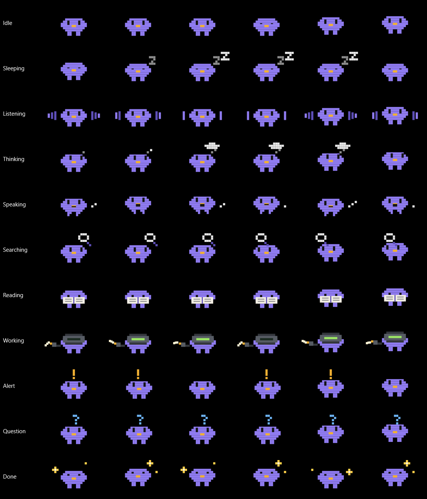

# Wrenlet

A small, unofficial Windows companion for the Claude desktop app and Claude Code in a terminal. A
notch on the edge of your screen shows what your sessions are doing, lets you answer permission
requests and questions, and lets you talk or type to Claude from anywhere.

It's a single, small exe with no dependencies.

> Wrenlet is an unofficial, independent project. It isn't made, endorsed, or supported by
> Anthropic. "Claude" is a trademark of Anthropic.



## Contents

- [Features](#features)
- [Install](#install)
- [Using it](#using-it)
- [Settings](#settings)
- [Privacy](#privacy)
- [Uninstall](#uninstall)
- [Build from source](#build-from-source)
- [How it works](#how-it-works)
- [Contributing](#contributing)
- [Credits and license](#credits-and-license)

## Features

- **Live sessions.** See every running Claude Code session, in the app or a terminal, and jump to
  any of them with a click.
- **Permission requests.** Allow or deny from the notch while you're away from the chat.
- **Claude's questions.** The question and its buttons appear on the notch.
- **Quick voice.** Push to talk to Claude without opening it, with answers read aloud in a natural
  voice. Speech recognition and the reading voice can both run on your PC.
- **Quick typing.** Double-press the shortcut for a small text box, and keep chatting there.
- **Open in Claude.** Move a long voice or typed chat into the Claude app to read it or continue.
- **A mascot that acts it out.** Clouds when it's thinking, a welding mask and torch when it's
  working, a magnifier when searching, a book when reading, and more.
- **Fits your screen.** Four styles, any edge of any display, and separate sizes for collapsed and
  open.

## Install

**Requirements:** Windows 10 or 11 and the [Claude desktop app](https://claude.ai/download) or
[Claude Code](https://claude.com/claude-code). Quick voice needs Claude Code, signed in
(`claude auth login`).

1. Download `Wrenlet.exe` from the
   [latest release](https://github.com/osam7a/wrenlet/releases/latest).
2. Run it. The exe isn't code-signed yet, so Windows SmartScreen may warn you: choose
   **More info**, then **Run anyway**. You can also [build it yourself](#build-from-source).

It installs itself:

1. Copies itself to `%LOCALAPPDATA%\Wrenlet`.
2. Starts with Windows, through the `HKCU\...\Run` key.
3. Adds its hooks to `~/.claude/settings.json`. The original file is kept as
   `settings.json.wrenlet-backup`.
4. Starts.

To update, run a newer exe the same way. Running it while it's already running opens the settings.

Claude Code reads hooks when a session starts, so sessions that were already open only report task
counts and permission requests after they restart. Session status and working time work for every
session right away.

## Using it

### Sessions

The notch shows the session you just left, or the one working, with its name, working time, and
tasks: `Working 4:12 · 3 done · 2 left`. Sessions are read from `~/.claude/sessions`. Hover to see
all of them (a laptop for app sessions, a terminal for CLI ones) and click one to jump to it. A
terminal session brings its terminal window forward. An app session opens Claude and selects it in
the sidebar.

### Permission requests

When a Claude app session needs permission while you're away from it, the notch shows what it wants
to run (`Bash: git push`) with **Allow** and **Deny**. If you go back to that chat instead, Claude
asks in its own window as usual (Claude being open on another chat doesn't count). A terminal
session asks in the terminal right away, and the notch shows a small notice with **Open terminal**.

A request always stays findable: on the notch until it's answered, or in that chat with a notice on
the notch. Several wait behind each other ("+1 more").

### Claude's questions

When a Claude app session ends its turn with a question and buttons, the notch shows the same
question with the same buttons, the recommended one highlighted. Clicking one presses that button in
Claude. If it can't be pressed, a reply button's text is sent to the session as your answer, and an
app action (Commit, Create PR, …) opens Claude so you can press it there. The question goes away
once you answer, in the notch or in Claude.

### The shortcut

The shortcut is the Copilot key by default, or your own key combination. What it does depends on
**Voice and prompts** in the settings:

| Mode | What the shortcut does |
| --- | --- |
| Quick voice | Push to talk: see below. Double-press it to type instead. |
| Claude voice | Starts a Claude voice conversation in the open chat and minimizes Claude, so you talk through the notch, with a timer, a mute button, and live bars. |
| Quick entry | Opens the Claude app's own quick entry (it presses Ctrl+Alt+Space). |

### Quick voice

Hold the shortcut while you speak, or press it once and talk. Let go and the question goes to a
Claude Code session running in the background. The answer streams onto the notch and is read aloud
sentence by sentence. Press the shortcut again to cut it off and ask something else.

**Typing.** Double-press the shortcut for a small text box under the chat. **Enter** sends and
**Shift+Enter** starts a new line. It's the same conversation, without speech. **Esc** closes it and
puts the focus back where it was.

**The panel** is a small chat: what you said in a bubble, the answer in large text, and the earlier
questions above it. It stays open while the pointer is on it. **Esc** closes it, like its ×.

**Open in Claude.** Hover the panel and click the open button to see the chat in the Claude app. A
private chat is saved to your Claude Code history at that moment, and not before.

**Cards.** When an answer has a key fact, it's shown as a card first, and never read aloud:

| Card | Shows |
| --- | --- |
| Value | One figure, big and bold, with what it is and a note. It can show a change (▲ up, ▼ down) and a progress bar. |
| List | Up to six name and value rows. |
| Steps | Numbered steps for a how-to. |
| Compare | Two or three things side by side, one row per point. |
| Weather | The temperature and its sign, and up to five days ahead. |

Claude sends a card as `<card>{json}</card>` before the spoken answer. To see them, run
`Wrenlet.exe --demo cards`, or `--demo quick` for a whole conversation.

**Minimized.** The − button shrinks quick voice to a small bar that stays up, with bars for your
voice and for the answer, and the answer's key figure. The shortcut works as usual, and clicking the
bar brings the conversation back. The bar goes away with its × or after 15 minutes unused.

**Reading voice:**

- **Natural** runs [KittenTTS](https://github.com/KittenML/KittenTTS) with
  [sherpa-onnx](https://github.com/k2-fsa/sherpa-onnx) on your PC, about six times faster than real
  time on a laptop CPU. It's an 85 MB download from the settings, checked against its SHA-256. It
  needs 64-bit Windows 10 1803 or later on an Intel or AMD processor.
- **ElevenLabs** uses your own API key. It's in the cloud, so answers are sent to ElevenLabs and use
  your credits. The key is stored encrypted for your Windows user with DPAPI. When it can't be
  reached, the natural or Windows voice reads instead for a few minutes.
- **Windows** uses a voice installed on your PC.

**Speech recognition:**

- **Built in** runs [whisper.cpp](https://github.com/ggml-org/whisper.cpp) with an English Whisper
  model on your PC, downloaded once from the settings (Accurate, 190 MB, or Fast, 60 MB) and checked
  against its SHA-256. Nothing leaves the computer.
- **Windows** uses its online speech recognition (the Win+H engine) when that's turned on in
  Settings → Privacy & security → Speech, or else the older offline engine.

**What it can use.** Web search only (fastest), or **your skills and connectors**, like a normal
session. Then anything beyond looking things up (sending, creating, running commands) waits for
**Allow** on the notch. Skills marked `disable-model-invocation` are listed for Claude with their
paths, so it reads one when your question falls under it or you name it.

**Answer style.** Answers follow the `voice-replies` skill
(`~/.claude/skills/voice-replies/SKILL.md`): short, plain spoken sentences with no markdown or
links. It's written on first use and yours to edit. An unedited one is updated with new versions.

**Follow-ups.** When a spoken answer ends on a question, the mic opens by itself once it's been
read. If you say nothing for 7 seconds, or press **Esc**, it closes and the answer stays on screen.
Turn it off with **Listen for my reply**.

**History.** *Private* saves nothing, and follow-ups keep context for 15 minutes. A private chat has
a trash button on the panel: the chat is gone and Claude forgets it too. *One chat, VOICE_CHATS*
keeps everything in your Claude Code history and picks it up again each time.

### The mascot

| Mood | When |
| --- | --- |
| Idle | Nothing's going on. |
| Sleeping | A session is open but has nothing to do. |
| Listening | The mic is open. |
| Thinking | Claude is working out its answer: little clouds. |
| Searching | It's searching the web: a magnifier. |
| Reading | It's reading or looking through files: a book. |
| Working | It's editing or running things: a welding mask, a torch, and sparks. |
| Speaking | An answer is being read aloud. |
| Alert | A permission request is waiting. |
| Question | Claude is asking you something. |
| Done | A turn just finished. |

### Staying out of the way

The notch hides while you're looking at Claude (the app, or the terminal running the session) and
over fullscreen apps. Its **×** hides it until you go back to Claude, or for 15 minutes or an hour.

**Esc** closes what just came up, one at a time. A permission request or a question goes back to
Claude's own prompt, with nothing allowed or denied. Quick voice has no prompt, so there it's a no,
noted in its chat. Esc still reaches the app you're in, and the notch only watches for it while
something is showing.

### Styles and sizes

*Classic* shows the mascot and a status line. *Compact* is one slim line. *Line* is a thin colored
bar and *Dot* is a small colored dot. Hover either one for details, and both open by themselves when
Claude needs you. Drag the notch and it snaps to the nearest edge.

Sizes (small, medium, large, extra large) are set separately for the notch at rest and for when it's
open.

### Command line

| Command | What it does |
| --- | --- |
| `Wrenlet.exe --here` | Run from where it is, without installing. |
| `Wrenlet.exe --demo` | Preview the notch's states without touching Claude (about a minute). `--demo quick` shows only quick voice, `--demo cards` each kind of card. |
| `Wrenlet.exe --settings` | Open the settings of the running copy. |
| `Wrenlet.exe --uninstall` | Remove the app, its hooks, and its startup entry. |

The tray icon has Settings, Type to Claude, Repair Claude Code hooks, and Quit.

## Settings

| Section | Options |
| --- | --- |
| General | Start with Windows. Answer permission requests from the notch. Show Claude's questions with their choices. Keep the hooks installed (repaired automatically every 5 minutes if something removes them). |
| Shortcut | Copilot key, your own key combination, or none. |
| Voice and prompts | Quick voice, Claude voice (with Claude's quick entry as the fallback without a mic), or always Claude's quick entry. Quick voice: speech recognition, what it can use, history, model, reading answers aloud, listening for your reply, the reading voice and its speed, and the answer style. |
| Notch | Style, size when collapsed, size when open, screen edge, display, position along the edge, whether to list sessions on hover. |
| When it shows | Only when something's going on (or Claude is minimized), whenever you're away from Claude, or only for permission requests and voice. How long × hides it. How long "Done" stays. Whether to show over fullscreen apps. |

Settings are saved in `%LOCALAPPDATA%\Wrenlet\settings.json`. Problems are written to
`Wrenlet.log` in the same folder.

## Privacy

Wrenlet has no account, server, or telemetry. It talks to other services only in these cases:

- **Claude.** Quick voice sends your questions to Claude through your own Claude Code.
- **Downloads.** The speech recognition model and the natural voice are downloaded when you choose
  them in the settings.
- **ElevenLabs.** Answers are sent there only if you choose that voice and add your key.
- **Windows speech.** Its online engine sends your voice to Microsoft if you've turned it on in
  Windows and picked the Windows engine.

## Uninstall

Use **Settings → Uninstall…**, or run `Wrenlet.exe --uninstall`, or `uninstall.ps1` from this
repository. Only Wrenlet's own hooks are removed from `~/.claude/settings.json`. Everything
else in that file stays as it is.

## Build from source

No SDK or Visual Studio is needed. It compiles with the C# compiler that ships with Windows (.NET
Framework 4.x).

```powershell
powershell -ExecutionPolicy Bypass -File .\build.ps1     # -> bin\Wrenlet.exe
powershell -ExecutionPolicy Bypass -File .\install.ps1   # build, then run it (installs/updates)
```

## How it works

```
Claude Code hooks ──stdin──> Wrenlet.exe --hook ──named pipe──> running notch
                   <─stdout── (allow / deny for PermissionRequest)
~/.claude/sessions/*.json ──polled every second──> session list
Claude window ──UI Automation──> voice, mute, current session title, prompt box
```

- **The pipe** is `\\.\pipe\Wrenlet-<your user SID>`. Only your Windows user can open it, and
  network clients are refused. The hook checks that the process on the other end is Wrenlet
  before sending anything. If the notch isn't running, the hook prints nothing and exits, so Claude
  Code behaves as if there were no hook.
- **Permission requests** are held for at most 9 minutes (the hook's timeout is 10). They are handed
  back to Claude's own prompt when you look at that chat, when its turn ends, or when you close
  them. After the 9 minutes a notice stays on the notch until you've gone to it. Quick voice's never
  go back to a prompt: they end as a no, noted in its chat.

| File | What it does |
| --- | --- |
| `src/Program.cs` | Entry point and command-line modes; the demo. |
| `src/Controller.cs` | Ties it together: what the notch shows and when, permission requests, the shortcut. |
| `src/HookServer.cs` | The named pipe, both ends (`--hook` relay and the server in the notch). |
| `src/HookInstaller.cs` | Adds, repairs, and removes the hooks in `~/.claude/settings.json`. |
| `src/Installer.cs` | Self-install, startup entry, update, uninstall. |
| `src/SessionScanner.cs` | Reads the live session files and checks each session's process is really alive. |
| `src/SessionTracker.cs` | Task lists and turn timing from hook events. |
| `src/SessionActivity.cs` | What a session is doing right now, from the end of its transcript. Drives the mascot. |
| `src/SessionHub.cs` | Merges these into one session list. |
| `src/ClaudeWatcher.cs` | Claude's window: open, minimized, in front, voice, mute, current session, fullscreen apps. |
| `src/VoiceLauncher.cs` | Starts voice mode; microphone detection. |
| `src/QuickVoice.cs` | Quick voice: speech recognition, the background Claude Code session, reading answers aloud, typing, opening a chat in Claude, the voice-replies skill. |
| `src/ModernDictation.cs` | Windows' modern (online) dictation, used by quick voice when allowed. |
| `src/LocalSpeech.cs`, `src/MicRecorder.cs` | The built-in speech recognition (whisper.cpp): download, checks, transcribing; recording the microphone. |
| `src/NaturalVoice.cs`, `src/AudioPlayer.cs` | The natural voice (KittenTTS through sherpa-onnx's C API): download, checks, speaking; playing it with its loudness for the bars. |
| `src/ElevenLabs.cs` | The ElevenLabs voice: speaking a sentence, listing your voices, keeping the key encrypted. |
| `src/ChoiceSender.cs` | Pressing the button you picked on the notch in Claude's window. |
| `src/PromptSender.cs` | Sending text to the Claude app's prompt box; opening its quick entry. |
| `src/TerminalFocus.cs` | Finds the terminal window a CLI session runs in. |
| `src/Hotkeys.cs` | The Copilot key hook, custom shortcuts, double-press, and Esc. |
| `src/NotchWindow.cs`, `src/Mascot.cs` | The notch and its pixel mascot. |
| `src/SettingsWindow.cs`, `src/TrayIcon.cs` | Settings and the tray icon. |
| `src/Settings.cs`, `src/Json.cs`, `src/Log.cs`, `src/Native.cs`, `src/Theme.cs`, `src/AssemblyInfo.cs` | Shared pieces and the version number. |

## Contributing

Bug reports and pull requests are welcome. See [CONTRIBUTING.md](CONTRIBUTING.md).

## Credits and license

Wrenlet is released under the [MIT License](LICENSE).

It downloads these separately, only if you choose them in the settings. They aren't part of the exe:

- [whisper.cpp](https://github.com/ggml-org/whisper.cpp) (MIT) and Whisper models
- [sherpa-onnx](https://github.com/k2-fsa/sherpa-onnx) (Apache 2.0)
- [KittenTTS](https://github.com/KittenML/KittenTTS) (Apache 2.0)
