# Claude Notch

A small notch on the edge of your Windows screen for Claude. See what your sessions are doing,
answer permission requests and questions, and talk or type to Claude from anywhere.

It's one small exe with no dependencies, and it works with the Claude desktop app and Claude Code.

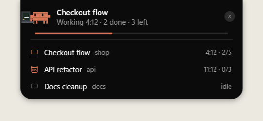

> Claude Notch is an independent community project. It isn't made, endorsed, or supported by
> Anthropic. "Claude" is a trademark of Anthropic.

## Install

You need Windows 10 or 11, and the [Claude desktop app](https://claude.ai/download) or
[Claude Code](https://claude.com/claude-code). Quick voice needs Claude Code, signed in.

**From a release:** download `ClaudeNotch.exe` from the
[latest release](https://github.com/osam7a/claude-notch/releases/latest) and run it. The exe isn't
code-signed yet, so if Windows SmartScreen warns you, choose **More info**, then **Run anyway**.

**From source:** no SDK needed, it builds with the compiler that ships with Windows.

```powershell
git clone https://github.com/osam7a/claude-notch
cd claude-notch
powershell -ExecutionPolicy Bypass -File .\install.ps1
```

Either way it installs itself to `%LOCALAPPDATA%\ClaudeNotch`, starts with Windows, and adds its
hooks to `~/.claude/settings.json`, keeping a backup of that file. To update, run a newer exe the
same way. Sessions that were already open report task counts and permission requests after they
restart.

## Features

### Follow your sessions

Every running session, in the app or a terminal, with its progress and time. Hover to see them all,
and click one to jump to it.


### Answer permission requests

Allow or deny from the notch while you're away from the chat.

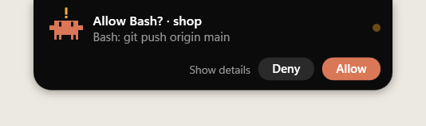

Click the request to see exactly what it's asking for.

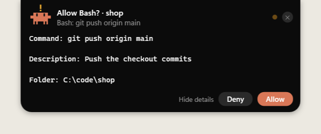

### Answer Claude's questions

When a session ends with a question, it appears on the notch with its buttons.

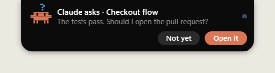

### Talk to Claude

Press the Copilot key or your own shortcut and just ask. Answers are read aloud, and speech
recognition and the reading voice can both run on your PC. Press Esc to cancel.

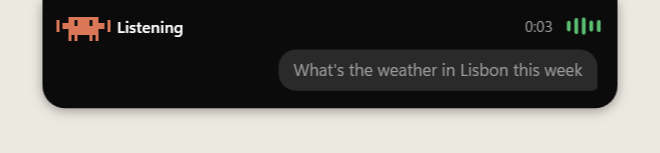

The key fact of an answer shows up as a card: a number, a list, steps, a comparison, or the weather.

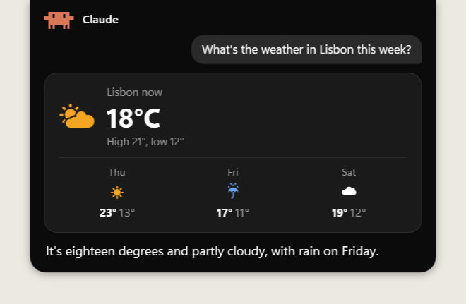

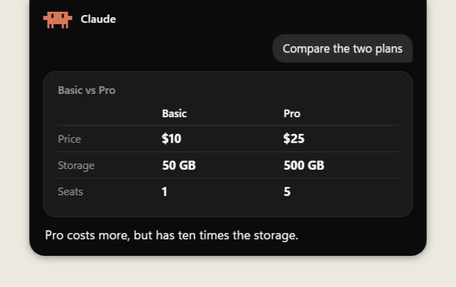

### Type to Claude

Double-press the shortcut for a small text box, and keep chatting there. You can move a long chat
into the Claude app to continue it.

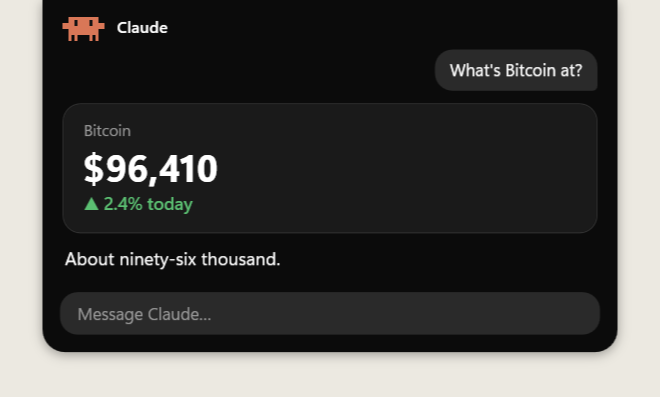

### Start new projects

Ask for a new project and Claude picks a name, model and effort, and writes a proper first prompt.
Nothing starts until you press Allow. Then it makes the folder and opens a real session in the app.

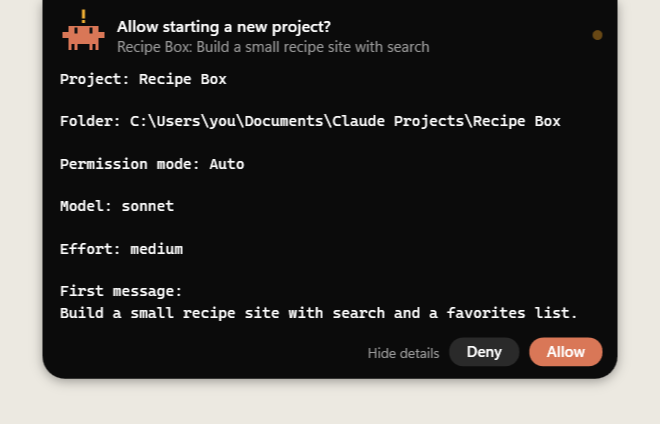

### Ask about your sessions

Ask by voice what a session is doing, its task list, or whether a finished one got done, without
interrupting it. Sending a session a message always needs your OK.

### A mascot that acts it out

Clouds when it's thinking, a laptop when it's working, a magnifier when searching, and more.

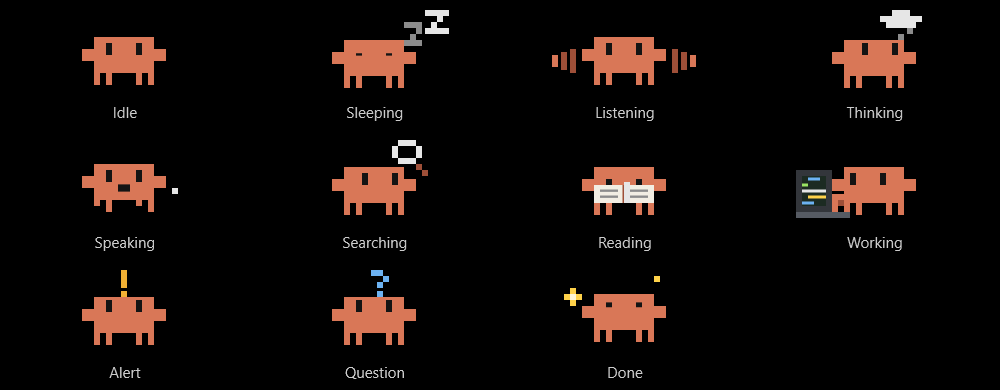

## Styles

Pick a style, drag the notch to any edge of any display, and set its size at rest and when open.

| Style | Looks like |
| --- | --- |
| **Classic**: mascot and status | 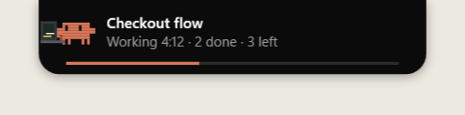 |
| **Compact**: one slim line | 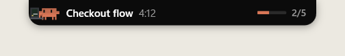 |
| **Line**: a thin bar, opens when Claude needs you |  |
| **Dot**: a small dot, opens when Claude needs you | 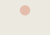 |

| Edge or size | Looks like |
| --- | --- |
| Left edge | 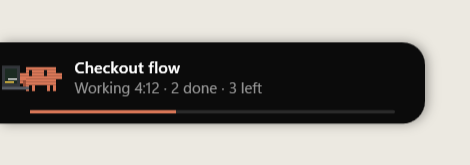 |
| Bottom edge | 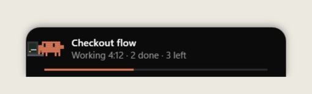 |
| Small | 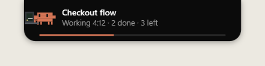 |
| Extra large | 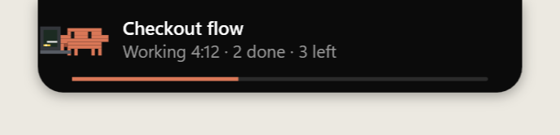 |

## Settings

Right-click the tray icon and choose **Settings**, or run the exe again while it's running.

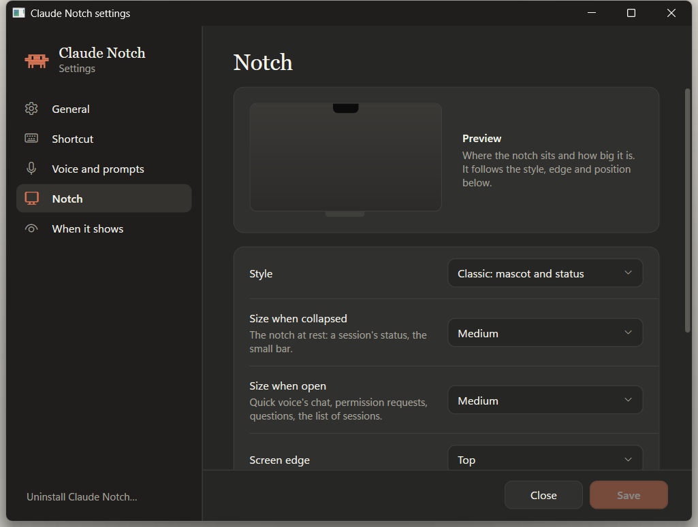

## Privacy

There's no account, server, or telemetry. Quick voice sends your questions to Claude through your
own Claude Code. Voices and speech models are only downloaded if you choose them, and ElevenLabs is
only used if you add your own key. The [guide](docs/guide.md#privacy) has the details.

## Uninstall

Use **Settings → Uninstall…**, or run `ClaudeNotch.exe --uninstall`. Only Claude Notch's own hooks
are removed from `~/.claude/settings.json`.

## More

- [The full guide](docs/guide.md): every option, shortcut and voice, and how it works.
- [Contributing](CONTRIBUTING.md): building, running the tests, and pull requests.
- Released under the [MIT License](LICENSE).
