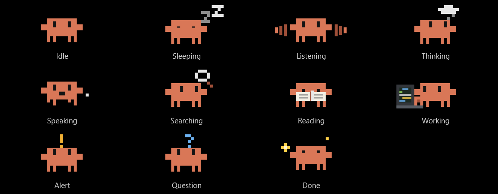

# Clawdock guide

A small Windows companion for Claude: the Claude desktop app and Claude Code in a terminal. A
notch on the edge of your screen shows what your sessions are doing, lets you answer permission
requests and questions, and lets you talk or type to Claude from anywhere.

It's a single, small exe with no dependencies. It runs entirely on your PC.

> Clawdock is an independent community project. It isn't made, endorsed, or supported by
> Anthropic. "Claude" is a trademark of Anthropic.



## Contents

- [Features](#features)
- [Install](#install)
- [Using it](#using-it)
- [Settings](#settings)
- [Privacy](#privacy)
- [Uninstall](#uninstall)
- [Build from source](#build-from-source)
- [How it works](#how-it-works)
- [Contributing](#contributing)
- [Credits and license](#credits-and-license)

## Features

- **Live sessions.** See every running Claude Code session, in the app or a terminal, and jump to
  any of them with a click.
- **Ask about your sessions.** Ask by voice what a session is doing, its task list, its model, or
  whether a finished one got done, without interrupting anything. Messaging a session always needs
  your OK.
- **Permission requests.** Allow or deny from the notch while you're away from the chat.
- **Claude's questions.** The question and its buttons appear on the notch.
- **Quick voice.** Push to talk to Claude without opening it, with answers read aloud in a natural
  voice. Speech recognition and the reading voice can both run on your PC.
- **Quick typing.** Double-press the shortcut for a small text box, and keep chatting there.
- **Open in Claude.** Move a long voice or typed chat into the Claude app to read it or continue.
- **A mascot that acts it out.** Clouds when it's thinking, typing on a laptop when it's
  working, a magnifier when searching, a book when reading, and more.
- **Fits your screen.** Four styles, any edge of any display, and separate sizes for collapsed and
  open.

## Install

**Requirements:** Windows 10 or 11 and the [Claude desktop app](https://claude.ai/download) or
[Claude Code](https://claude.com/claude-code). Quick voice needs Claude Code, signed in
(`claude auth login`).

1. Download `Clawdock.exe` from the
   [latest release](https://github.com/osam7a/clawdock/releases/latest).
2. Run it. The exe isn't code-signed yet, so Windows SmartScreen may warn you: choose
   **More info**, then **Run anyway**. You can [check the download first](../SECURITY.md#checking-a-download)
   or [build it yourself](#build-from-source).

It installs itself:

1. Copies itself to `%LOCALAPPDATA%\Clawdock`.
2. Starts with Windows, through the `HKCU\...\Run` key.
3. Adds its hooks to `~/.claude/settings.json`. The original file is kept as
   `settings.json.clawdock-backup`.
4. Starts.

Running a newer exe the same way also updates it. Running it while it's already running opens the
settings.

The installed copy also updates itself. It checks GitHub for a new release two minutes after it
starts and every 6 hours after that, downloads the exe, and checks that it's this app at that
version. It installs when no session is working and nothing is waiting on you, and restarts by
itself. A permission request you haven't answered and quick voice in use always hold it back; anything
else does for a day at most. To turn it off or check now, use **Settings → General → Updates**.

Claude Code reads hooks when a session starts, so sessions that were already open only report task
counts and permission requests after they restart. Session status and working time work for every
session right away.

## Using it

### Sessions

The notch shows the session you just left, or the one working, with its name, working time, and
tasks: `Working 4:12 · 3 done · 2 left`. Sessions are read from `~/.claude/sessions`. Hover to see
all of them (a laptop for app sessions, a terminal for CLI ones) and click one to jump to it. A
terminal session brings its terminal window forward. An app session opens Claude and selects it in
the sidebar.

### Permission requests

When a Claude app session needs permission while you're away from it, the notch shows what it wants
to run (`Bash: git push`) with **Allow** and **Deny**. If you go back to that chat instead, Claude
asks in its own window as usual (Claude being open on another chat doesn't count). A terminal
session asks in the terminal right away, and the notch shows a small notice with **Open terminal**.

Click the request to see exactly what it's asking for: the whole command, the edit it wants to make,
and the folder. Click again to close it. To go to Claude instead, right-click and choose **Open Claude**.

A request always stays findable: on the notch until it's answered, or in that chat with a notice on
the notch. Several wait behind each other ("+1 more").

### Claude's questions

When a Claude app session ends its turn with a question and buttons, the notch shows the same
question with the same buttons, the recommended one in clay. Clicking one presses that button in
Claude. If it can't be pressed, a reply button's text is sent to the session as your answer, and an
app action (Commit, Create PR, …) opens Claude so you can press it there. The question goes away
once you answer, in the notch or in Claude.

### The shortcut

The shortcut is the Copilot key by default, or your own key combination. It starts quick voice by
default. What it does depends on **Voice and prompts** in the settings:

| Mode | What the shortcut does |
| --- | --- |
| Quick voice | Push to talk: see below. Double-press it to type instead. |
| Claude voice | Starts a Claude voice conversation in the open chat and minimizes Claude, so you talk through the notch, with a timer, a mute button, and live bars. |
| Quick entry | Opens the Claude app's own quick entry (it presses Ctrl+Alt+Space). |

### Quick voice

Hold the shortcut while you speak, or press it once and talk. Let go and the question goes to a
Claude Code session running in the background. The answer streams onto the notch and is read aloud
sentence by sentence. Press the shortcut again to cut it off and ask something else.

**Typing.** Double-press the shortcut for a small text box under the chat. **Enter** sends and
**Shift+Enter** starts a new line. It's the same conversation, without speech. **Esc** closes it and
puts the focus back where it was.

**The panel** is a small chat: what you said in a bubble, the answer in large text, and the earlier
questions above it. It stays open while the pointer is on it. **Esc** closes it, like its ×. **Esc** while you're talking, or while it's working on what you said, cancels it, so nothing more is sent.

**Open in Claude.** Hover the panel and click the open button to see the chat in the Claude app. A
private chat is saved to your Claude Code history at that moment, and not before.

**Your other sessions.** Ask about the sessions you have running: "Which sessions are working on
CinemaCAD?", "What's each one doing?", "Check the task list for Agent C", "Which model is Agent B on?" Quick
voice answers from a snapshot of their transcripts, taken just before each question, so those sessions
aren't messaged or interrupted and don't spend anything.

If only the session itself can answer, or you ask quick voice to tell it something, the notch shows the
exact message with **Allow** and **Deny**, and nothing is sent without Allow. In the Claude app, Allow opens
that chat and sends the message, and only if that chat is confirmed open. For a terminal session, or if
it can't be confirmed, the terminal or chat comes forward and the message is on your clipboard to paste.

**New projects.** Say "start a new project called Lab Tracker and set up a basic site". After you press
**Allow**, it makes the folder (`Documents\Claude Projects` unless you change it), starts a Claude Code session there, opens it
in the Claude app, and sends your first message. Quick voice writes that message as a proper prompt and picks the model and effort for the size of the
work (never Fable, which spends usage credits, unless you ask), and the Allow card shows what it chose. It won't use a folder that already has something in it. If the chat
can't be confirmed open, the message goes on your clipboard to paste. New projects start in Auto mode, where Claude Code's safety
checks decide what can run rather than asking each time. You can turn that off in Settings. The app has no documented way to start a session
like this, so an app update could stop it working.

**Finished sessions.** It can also search every Claude Code session on your PC, running or finished: "Did you
finish pushing those screenshots?" Each transcript is read once in the background into a short digest of what was
asked and said, and again only when it changes. It answers from those, going by the session's last words and
task list. Regular chats in the Claude app aren't on your PC, so it can't see them, and it says so when it
finds nothing.

**Cards.** When an answer has a key fact, it's shown as a card first, and never read aloud:

| Card | Shows |
| --- | --- |
| Value | One figure, big and bold, with what it is and a note. It can show a change (▲ up, ▼ down) and a progress bar. |
| List | Up to six name and value rows. |
| Steps | Numbered steps for a how-to. |
| Compare | Two or three things side by side, one row per point. |
| Weather | The temperature and its sign, and up to five days ahead. |

Claude sends a card as `<card>{json}</card>` before the spoken answer. To see them, run
`Clawdock.exe --demo cards`, or `--demo quick` for a whole conversation.

**Minimized.** The − button shrinks quick voice to a small bar that stays up, with bars for your
voice and for the answer, and the answer's key figure. The shortcut works as usual, and clicking the
bar brings the conversation back. The bar goes away with its × or after 15 minutes unused.

**Reading voice:**

- **Natural** runs [KittenTTS](https://github.com/KittenML/KittenTTS) with
  [sherpa-onnx](https://github.com/k2-fsa/sherpa-onnx) on your PC, about six times faster than real
  time on a laptop CPU. This is the default, with the voice Bruno. It's an 85 MB download on first run
or from the settings, checked against its SHA-256. It
  needs 64-bit Windows 10 1803 or later on an Intel or AMD processor.
- **ElevenLabs** uses your own API key. It's in the cloud, so answers are sent to ElevenLabs and use
  your credits. The key is stored encrypted for your Windows user with DPAPI. When it can't be
  reached, the natural or Windows voice reads instead for a few minutes.
- **Windows** uses a voice installed on your PC.

**Speech recognition:**

- **Built in** runs [whisper.cpp](https://github.com/ggml-org/whisper.cpp) with an English Whisper
  model on your PC. This is the default, with the Fast model. It's downloaded once and checked against
  its SHA-256: Fast (60 MB) on first run, or Accurate (190 MB) from the settings. Nothing leaves the
  computer.
- **Windows** uses its online speech recognition (the Win+H engine) when that's turned on in
  Settings → Privacy & security → Speech, or else the older offline engine.

**What it can use.** Web search only (fastest), or **your skills and connectors**, like a normal
session. Then anything beyond looking things up (sending, creating, running commands) waits for
**Allow** on the notch. Skills marked `disable-model-invocation` are listed for Claude with their
paths, so it reads one when your question falls under it or you name it.

**Answer style.** Answers follow the `voice-replies` skill
(`~/.claude/skills/voice-replies/SKILL.md`): short, plain spoken sentences with no markdown or
links. It's written on first use and yours to edit. An unedited one is updated with new versions.

**Follow-ups.** When a spoken answer ends on a question, the mic opens by itself once it's been
read. If you say nothing for 7 seconds, or press **Esc**, it closes and the answer stays on screen.
Turn it off with **Listen for my reply**.

**History.** *Private* saves nothing, and follow-ups keep context for 15 minutes. A private chat has
a trash button on the panel: the chat is gone and Claude forgets it too. *One chat, VOICE_CHATS*
keeps everything in your Claude Code history and picks it up again each time.

### The mascot

| Mood | When |
| --- | --- |
| Idle | Nothing's going on. |
| Sleeping | A session is open but has nothing to do. |
| Listening | The mic is open. |
| Thinking | Claude is working out its answer: little clouds. |
| Searching | It's searching the web: a magnifier. |
| Reading | It's reading or looking through files: a book. |
| Working | It's editing or running things: typing on a laptop, with code filling the screen. |
| Speaking | An answer is being read aloud. |
| Alert | A permission request is waiting. |
| Question | Claude is asking you something. |
| Done | A turn just finished. |

### Staying out of the way

The notch hides while you're looking at Claude (the app, or the terminal running the session) and
over fullscreen apps. Its **×** hides it until you go back to Claude, or for 15 minutes or an hour.

**Esc** closes what just came up, one at a time. A permission request or a question goes back to
Claude's own prompt, with nothing allowed or denied. Quick voice has no prompt, so there it's a no,
noted in its chat. Esc still reaches the app you're in, and the notch only watches for it while
something is showing.

### Styles and sizes

*Classic* shows the mascot and a status line. *Compact* is one slim line. *Line* is a thin colored
bar and *Dot* is a small colored dot. Hover either one for details, and both open by themselves when
Claude needs you. Drag the notch and it snaps to the nearest edge.

Sizes (small, medium, large, extra large) are set separately for the notch at rest and for when it's
open.

### Command line

| Command | What it does |
| --- | --- |
| `Clawdock.exe --here` | Run from where it is, without installing. |
| `Clawdock.exe --demo` | Preview the notch's states without touching Claude (about a minute). `--demo quick` shows only quick voice, `--demo cards` each kind of card. |
| `Clawdock.exe --settings` | Open the settings of the running copy. |
| `Clawdock.exe --uninstall` | Remove the app, its hooks, and its startup entry. |

The tray icon has Settings, Type to Claude, Repair Claude Code hooks, and Quit.

## Settings

| Section | Options |
| --- | --- |
| General | Start with Windows. Answer permission requests from the notch. Show Claude's questions with their choices. Keep the hooks installed (repaired automatically every 5 minutes if something removes them). |
| Shortcut | Copilot key, your own key combination, or none. |
| Voice and prompts | Quick voice, Claude voice (with Claude's quick entry as the fallback without a mic), or always Claude's quick entry. Quick voice: speech recognition, what it can use, history, model, reading answers aloud, listening for your reply, the reading voice and its speed, and the answer style. |
| Notch | Style, size when collapsed, size when open, screen edge, display, position along the edge, whether to list sessions on hover. |
| When it shows | Only when something's going on (or Claude is minimized), whenever you're away from Claude, or only for permission requests and voice. How long × hides it. How long "Done" stays. Whether to show over fullscreen apps. |

Settings are saved in `%LOCALAPPDATA%\Clawdock\settings.json`. Problems are written to
`Clawdock.log` in the same folder.

## Privacy

Clawdock has no account, server, or telemetry. It talks to other services only in these cases:

- **Claude.** Quick voice sends your questions to Claude through your own Claude Code. When you ask
  about your sessions, that includes parts of their transcripts: recent requests, replies, and tool
  descriptions. Those snapshots are kept in `%LOCALAPPDATA%\Clawdock\voice` until the next question, and digests of each
  session's requests and replies stay there until you uninstall.
- **Downloads.** On first run it downloads the speech recognition model and the natural voice from
  GitHub and Hugging Face, about 160 MB. Other models and voices are downloaded when you choose them.
- **Updates.** It asks GitHub for the latest release every 6 hours and downloads it if it's newer,
  unless you turn off **Update automatically**. GitHub sees the request as it would any other.
- **ElevenLabs.** Answers are sent there only if you choose that voice and add your key.
- **Windows speech.** Its online engine sends your voice to Microsoft if you've turned it on in
  Windows and picked the Windows engine.

## Uninstall

Use **Settings → Uninstall…**, or run `Clawdock.exe --uninstall`, or `uninstall.ps1` from this
repository. Only Clawdock's own hooks are removed from `~/.claude/settings.json`. Everything
else in that file stays as it is.

## Build from source

No SDK or Visual Studio is needed. It compiles with the C# compiler that ships with Windows (.NET
Framework 4.x).

```powershell
powershell -ExecutionPolicy Bypass -File .\build.ps1     # -> bin\Clawdock.exe
powershell -ExecutionPolicy Bypass -File .\install.ps1   # build, then run it (installs/updates)
```

## How it works

```
Claude Code hooks ──stdin──> Clawdock.exe --hook ──named pipe──> running notch
                   <─stdout── (allow / deny for PermissionRequest)
~/.claude/sessions/*.json ──polled every second──> session list
Claude window ──UI Automation──> voice, mute, current session title, prompt box
```

- **The pipe** is `\\.\pipe\Clawdock-<your user SID>`. Only your Windows user can open it, and
  network clients are refused. The hook checks that the process on the other end is Clawdock
  before sending anything. If the notch isn't running, the hook prints nothing and exits, so Claude
  Code behaves as if there were no hook.
- **Permission requests** are held for at most 9 minutes (the hook's timeout is 10). They are handed
  back to Claude's own prompt when you look at that chat, when its turn ends, or when you close
  them. After the 9 minutes a notice stays on the notch until you've gone to it. Quick voice's never
  go back to a prompt: they end as a no, noted in its chat.

| Folder | What's in it |
| --- | --- |
| `src/App` | Start-up and command-line modes, the Controller that ties everything together (`Controller.*.cs`), self-install, shortcuts, the tray icon, and shared helpers. |
| `src/Claude` | Talking to Claude: the hook pipe and installer, watching the app's window, sending prompts and answers, starting voice and new projects. |
| `src/Sessions` | Finding sessions and what they're doing: live files, hook events, transcripts and digests. |
| `src/Voice` | Quick voice (`QuickVoice.*.cs`: listening, the background Claude session, answers, speaking, instructions), speech recognition, and the reading voices. |
| `src/Notch` | The notch window (`NotchWindow.*.cs`: rendering, chat, cards, lists), its state, the mascot, and the theme. |
| `src/SettingsUi` | The settings, their window (`SettingsWindow.*.cs`), and its colors. |
| `tests` | The automated tests. |
| `tools` | The screenshot tool and the release notes script. |

## Contributing

Bug reports and pull requests are welcome. See [CONTRIBUTING.md](../CONTRIBUTING.md).

## Credits and license

Clawdock is released under the [MIT License with an attribution requirement](../LICENSE): forks and
copies must show "Based on Clawdock by Ousama Alhennawi" in their settings or about screen.

It downloads these separately on first run. They aren't part of the exe:

- [whisper.cpp](https://github.com/ggml-org/whisper.cpp) (MIT) and Whisper models
- [sherpa-onnx](https://github.com/k2-fsa/sherpa-onnx) (Apache 2.0)
- [KittenTTS](https://github.com/KittenML/KittenTTS) (Apache 2.0)
